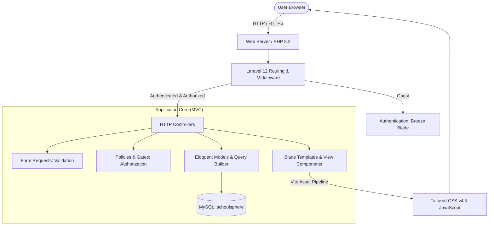
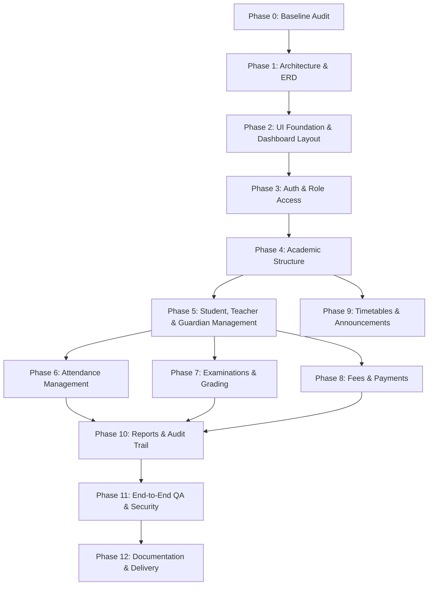

# SchoolSphere — System Architecture & Design Specification

## 1. Architectural Overview

SchoolSphere is designed as a modular, monolithic Laravel 12 application adhering to standard MVC (Model-View-Controller) principles with server-rendered Blade templates, Tailwind CSS v4 for styling, and MySQL for relational persistence.

---

## 2. Technology Stack & Constraints

| Layer | Technology | Details & Justification |
| :--- | :--- | :--- |
| **Backend Framework** | Laravel 12.x | Modern PHP framework with built-in routing, auth scaffolding, ORM, migrations, and test harness. |
| **PHP Runtime** | PHP 8.2.12 (CLI) | Installed via XAMPP on Windows. Meets Laravel 12 baseline (`^8.2`). |
| **Database** | MySQL / MariaDB 10.4 | Relational DB engine managed via XAMPP on port 3306. Strict relational integrity with foreign keys. |
| **Frontend Rendering** | Laravel Blade | Server-rendered templates avoiding unnecessary SPA/Inertia complexity. |
| **Styling** | Tailwind CSS v4.x | Utility-first CSS using `@tailwindcss/vite` without legacy PostCSS overhead. |
| **Build Tooling** | Vite 7.x & npm 11.x | Fast HMR during local development and optimized production asset bundling. |
| **Icons** | SVG / Lucide | Clean, consistent icons rendered as inline Blade components. |
| **Testing** | PHPUnit 11.x | Automated unit and feature testing using SQLite in-memory for speed and isolation. |

---

## 3. Users, Roles & Authorization Strategy

### 3.1 Roles Matrix
The application supports four distinct user roles, stored as an enum column (`role`) on the `users` table:

1. **`admin` (Administrator):** Complete operational control over academic years, classes, subjects, enrollments, users, staff, exams, fees, timetables, notices, and system logs.
2. **`teacher` (Teacher):** Restricted to assigned classes, sections, and subjects. Can record attendance, view class timetables, and submit examination marks for allocated subjects.
3. **`student` (Student):** Self-service portal to view attendance history, published marks, personal timetable, announcements, and fee payment status.
4. **`parent` (Parent/Guardian):** Linked portal allowing access only to specific verified students. Can view attendance, report cards, timetables, and fee invoices for their linked children.

### 3.2 Authorization Enforcement Strategy
Authorization is enforced at multiple server-side layers:
1. **Authentication Middleware (`auth`):** Blocks unauthenticated guests from internal dashboards.
2. **Active Status Middleware (`EnsureAccountIsActive`):** Checks `users.status === 'active'` on every request to immediately revoke deactivated accounts without destroying data.
3. **Role Middleware (`role:admin`, `role:teacher`, etc.):** Protects top-level route groups.
4. **Laravel Policies & Form Requests:**
   - Resource policies (e.g. `AttendancePolicy`, `ExamResultPolicy`) verify that teachers can only submit marks or attendance for classes assigned to them in `teaching_assignments`.
   - `StudentPolicy` and `GuardianPolicy` verify that parents can only inspect records where an explicit relationship exists in `student_guardians`.
   - Form Requests validate all inputs server-side, preventing mass-assignment tampering (e.g. role escalation or unauthorized student IDs).

---

## 4. Module Dependency Order

To build the system safely without broken references, development must proceed in strict dependency order:

---

## 5. Route Structure & Permission Plan

### 5.1 Public / Guest Routes
* `GET  /` &rarr; Landing / Welcome page
* `GET  /login` &rarr; Authentication Login view
* `POST /login` &rarr; Login authentication handler
* `POST /logout` &rarr; Session termination handler
* `GET  /forgot-password` &rarr; Password reset request view
* `POST /forgot-password` &rarr; Password reset email dispatch

### 5.2 Common Authenticated Routes (`middleware: ['auth', 'active']`)
* `GET  /dashboard` &rarr; Redirects to role-specific dashboard (`/admin/dashboard`, `/teacher/dashboard`, `/student/dashboard`, `/parent/dashboard`)
* `GET  /profile` &rarr; Profile management view
* `PATCH /profile` &rarr; Profile update handler
* `PUT  /password` &rarr; Password change handler

### 5.3 Administrator Routes (`middleware: ['auth', 'active', 'role:admin']`)
* `/admin/dashboard` &rarr; Real metrics, enrollment summaries, attendance rates, fee collection
* `/admin/academic-years` &rarr; Academic year lifecycle management
* `/admin/classes` &rarr; Classes & sections
* `/admin/subjects` &rarr; Subjects & class mappings
* `/admin/teachers` &rarr; Teacher profiles & teaching assignments
* `/admin/students` &rarr; Student admission, profiles, and enrollments
* `/admin/guardians` &rarr; Guardian profiles & student linkage
* `/admin/attendance` &rarr; Attendance oversight & session reports
* `/admin/exams` &rarr; Exam creation, schedule, grading scales, results publication
* `/admin/fees` &rarr; Fee structures, invoices, payment entries, balance tracking
* `/admin/timetables` &rarr; Weekly schedule builder with conflict validation
* `/admin/announcements` &rarr; Audience-targeted notice publication
* `/admin/reports` &rarr; Aggregate reports & exports
* `/admin/audit-logs` &rarr; Activity audit records

### 5.4 Teacher Routes (`middleware: ['auth', 'active', 'role:teacher']`)
* `/teacher/dashboard` &rarr; Assigned classes, today's schedule, pending tasks
* `/teacher/classes` &rarr; Enrolled student rosters for assigned sections
* `/teacher/attendance` &rarr; Bulk attendance entry for assigned classes
* `/teacher/exams` &rarr; Marks entry for authorized subjects
* `/teacher/timetable` &rarr; Teacher weekly teaching timetable
* `/teacher/announcements` &rarr; Teacher-targeted notices

### 5.5 Student Routes (`middleware: ['auth', 'active', 'role:student']`)
* `/student/dashboard` &rarr; Today's classes, attendance summary, recent grades, notices
* `/student/profile` &rarr; Read-only student record & enrollment history
* `/student/attendance` &rarr; Personal attendance calendar and percentages
* `/student/results` &rarr; Published examination report cards
* `/student/timetable` &rarr; Weekly class timetable
* `/student/fees` &rarr; Invoices and receipt payment history (read-only)
* `/student/announcements` &rarr; School announcements

### 5.6 Parent Routes (`middleware: ['auth', 'active', 'role:parent']`)
* `/parent/dashboard` &rarr; Overview with child switcher for multi-student parents
* `/parent/students/{student}/attendance` &rarr; Child's attendance history
* `/parent/students/{student}/results` &rarr; Child's published exam results
* `/parent/students/{student}/timetable` &rarr; Child's timetable
* `/parent/students/{student}/fees` &rarr; Child's fee invoices & payment receipts
* `/parent/announcements` &rarr; Parent-targeted notices

---

## 6. Frontend Layout & Design System Tokens

### 6.1 Theme Tokens (Tailwind CSS v4)
* **Primary Brand:** Deep Navy / Slate (`#0f172a`, `#1e293b`) for sidebar navigation, headers, and primary emphasis.
* **Accent / Action:** Indigo (`#4f46e5`, `#4338ca`) for primary call-to-action buttons, active navigation states, and focus rings.
* **Surface Background:** Warm Neutral Light (`#f8fafc`, `#f1f5f9`) for application backgrounds.
* **Card & Content Surfaces:** Pure White (`#ffffff`) with border (`#e2e8f0`) and subtle elevation (`shadow-xs`, `shadow-sm`).
* **Text Hierarchy:**
  * Headings: `font-semibold text-slate-900`
  * Body: `text-sm text-slate-700`
  * Secondary / Captions: `text-xs text-slate-500`
* **Status Badges:**
  * Success / Present / Paid: `bg-emerald-50 text-emerald-700 border-emerald-200`
  * Danger / Absent / Overdue: `bg-rose-50 text-rose-700 border-rose-200`
  * Warning / Late / Partial: `bg-amber-50 text-amber-700 border-amber-200`
  * Info / Draft / Notice: `bg-sky-50 text-sky-700 border-sky-200`

### 6.2 Layout Architecture
1. **Collapsible Sidebar:** Navigation grouped logically by functional domain with responsive mobile slide-out drawer.
2. **Top Navigation Bar:** SchoolSphere branding, page context, global search / notifications placeholder, and user profile dropdown with logout button.
3. **Action Breadcrumb Header:** Clear page title, contextual action button (e.g. "Add Student"), and status badges.
4. **Flash Message Notification Area:** Standardized banners for `success`, `error`, and `warning` session messages.
5. **Main Responsive Canvas:** Accessible grid/flex containers providing comfortable viewports on mobile, tablet, and desktop screens.
