# SchoolSphere — Database ERD & Schema Specification

## 1. Overview & Data Integrity Principles

The database design adheres strictly to relational database principles with MySQL / MariaDB conventions in Laravel 12:
1. **Explicit Foreign Keys:** Enforced at database engine level with cascade or restrict rules.
2. **Historical Preservation:** Student enrollments are linked per academic year, ensuring past academic history remains intact even after students move up grades or exit.
3. **Financial Precision:** Currency fields use `DECIMAL(10, 2)` to eliminate floating-point rounding errors.
4. **Duplicate Prevention:** Unique composite keys prevent duplicate attendance records for the same student session, duplicate marks entries for the same exam subject, and conflicting timetable allocations.
5. **Soft Deactivation over Silent Deletion:** Profiles and accounts utilize status enums (`active`, `inactive`) rather than destructive cascading deletes.

---

## 2. Mermaid Entity-Relationship Diagram

```mermaid
erDiagram
    USERS ||--o| STUDENTS : "profile for student"
    USERS ||--o| TEACHERS : "profile for teacher"
    USERS ||--o| GUARDIANS : "profile for guardian"
    USERS ||--o{ AUDIT_LOGS : "performed action"
    USERS ||--o{ ANNOUNCEMENTS : "published"

    STUDENTS ||--|{ STUDENT_GUARDIANS : "has"
    GUARDIANS ||--|{ STUDENT_GUARDIANS : "linked to"

    ACADEMIC_YEARS ||--|{ ENROLLMENTS : "contains"
    ACADEMIC_YEARS ||--|{ TEACHING_ASSIGNMENTS : "valid during"
    ACADEMIC_YEARS ||--|{ ATTENDANCE_SESSIONS : "occurs in"
    ACADEMIC_YEARS ||--|{ EXAMS : "conducted in"
    ACADEMIC_YEARS ||--|{ FEE_INVOICES : "billed for"
    ACADEMIC_YEARS ||--|{ TIMETABLE_ENTRIES : "scheduled in"

    CLASSES ||--|{ CLASS_SECTIONS : "subdivided into"
    CLASSES ||--|{ CLASS_SUBJECTS : "teaches"
    SUBJECTS ||--|{ CLASS_SUBJECTS : "included in"

    CLASS_SECTIONS ||--|{ ENROLLMENTS : "enrolled into"
    CLASS_SECTIONS ||--|{ TEACHING_ASSIGNMENTS : "assigned to"
    CLASS_SECTIONS ||--|{ ATTENDANCE_SESSIONS : "conducted for"
    CLASS_SECTIONS ||--|{ TIMETABLE_ENTRIES : "scheduled for"

    STUDENTS ||--|{ ENROLLMENTS : "has academic history"
    STUDENTS ||--|{ ATTENDANCES : "marked present/absent"
    STUDENTS ||--|{ EXAM_RESULTS : "achieves"
    STUDENTS ||--|{ FEE_INVOICES : "billed"

    TEACHERS ||--|{ TEACHING_ASSIGNMENTS : "assigned"
    TEACHERS ||--|{ TIMETABLE_ENTRIES : "scheduled to teach"
    SUBJECTS ||--|{ TEACHING_ASSIGNMENTS : "allocated"
    SUBJECTS ||--|{ EXAM_SUBJECTS : "examined"

    ATTENDANCE_SESSIONS ||--|{ ATTENDANCES : "records"

    EXAMS ||--|{ EXAM_SUBJECTS : "tests"
    EXAM_SUBJECTS ||--|{ EXAM_RESULTS : "graded on"

    FEE_TYPES ||--|{ FEE_INVOICE_ITEMS : "categorized by"
    FEE_INVOICES ||--|{ FEE_INVOICE_ITEMS : "contains"
    FEE_INVOICES ||--|{ PAYMENTS : "paid against"

    USERS {
        bigint id PK
        string name
        string email UK
        string password
        enum role "admin, teacher, student, parent"
        enum status "active, inactive"
        timestamp email_verified_at
        timestamps created_at_updated_at
    }

    STUDENTS {
        bigint id PK
        bigint user_id FK "nullable"
        string admission_number UK
        string first_name
        string last_name
        enum gender "male, female, other"
        date date_of_birth
        string blood_group "nullable"
        string address "nullable"
        string phone "nullable"
        date admission_date
        enum status "active, inactive, graduated, transferred"
        timestamps created_at_updated_at
    }

    TEACHERS {
        bigint id PK
        bigint user_id FK "nullable"
        string employee_number UK
        string first_name
        string last_name
        enum gender "male, female, other"
        string email UK "nullable"
        string phone
        string qualification "nullable"
        date joining_date
        enum status "active, inactive"
        timestamps created_at_updated_at
    }

    GUARDIANS {
        bigint id PK
        bigint user_id FK "nullable"
        string first_name
        string last_name
        string relationship
        string phone
        string email "nullable"
        string occupation "nullable"
        string address "nullable"
        timestamps created_at_updated_at
    }

    STUDENT_GUARDIANS {
        bigint id PK
        bigint student_id FK
        bigint guardian_id FK
        string relation_type "father, mother, legal_guardian, other"
        boolean is_primary
        timestamps created_at_updated_at
    }

    ACADEMIC_YEARS {
        bigint id PK
        string name "e.g. 2026-2027"
        date start_date
        date end_date
        boolean is_current
        enum status "upcoming, active, closed"
        timestamps created_at_updated_at
    }

    CLASSES {
        bigint id PK
        string name "e.g. Grade 10"
        integer numeric_level "e.g. 10"
        timestamps created_at_updated_at
    }

    CLASS_SECTIONS {
        bigint id PK
        bigint class_id FK
        string name "e.g. Section A"
        integer capacity "default 40"
        string room_number "nullable"
        timestamps created_at_updated_at
    }

    SUBJECTS {
        bigint id PK
        string name "e.g. Mathematics"
        string code UK "e.g. MATH-10"
        enum type "theory, practical, composite"
        timestamps created_at_updated_at
    }

    CLASS_SUBJECTS {
        bigint id PK
        bigint class_id FK
        bigint subject_id FK
        timestamps created_at_updated_at
    }

    TEACHING_ASSIGNMENTS {
        bigint id PK
        bigint academic_year_id FK
        bigint teacher_id FK
        bigint class_section_id FK
        bigint subject_id FK
        timestamps created_at_updated_at
    }

    ENROLLMENTS {
        bigint id PK
        bigint student_id FK
        bigint academic_year_id FK
        bigint class_section_id FK
        string roll_number "nullable"
        enum status "enrolled, promoted, repeated, transferred, withdrawn"
        timestamps created_at_updated_at
    }

    ATTENDANCE_SESSIONS {
        bigint id PK
        bigint academic_year_id FK
        bigint class_section_id FK
        bigint recorded_by_user_id FK
        date attendance_date
        enum status "submitted, verified"
        timestamps created_at_updated_at
    }

    ATTENDANCES {
        bigint id PK
        bigint attendance_session_id FK
        bigint student_id FK
        enum status "present, absent, late, excused"
        string remarks "nullable"
        timestamps created_at_updated_at
    }

    EXAMS {
        bigint id PK
        bigint academic_year_id FK
        string name "e.g. Mid-Term Examination 2026"
        date start_date
        date end_date
        enum status "draft, published, completed"
        timestamps created_at_updated_at
    }

    EXAM_SUBJECTS {
        bigint id PK
        bigint exam_id FK
        bigint class_id FK
        bigint subject_id FK
        date exam_date
        time start_time
        time end_time
        decimal max_marks "default 100.00"
        decimal pass_marks "default 40.00"
        timestamps created_at_updated_at
    }

    EXAM_RESULTS {
        bigint id PK
        bigint exam_subject_id FK
        bigint student_id FK
        decimal marks_obtained
        string grade "nullable"
        string remarks "nullable"
        timestamps created_at_updated_at
    }

    GRADING_SCALES {
        bigint id PK
        string grade "A+, A, B, C, F"
        decimal min_percentage
        decimal max_percentage
        decimal grade_point "4.00, 3.50, etc."
        string description "nullable"
        timestamps created_at_updated_at
    }

    FEE_TYPES {
        bigint id PK
        string name "Tuition, Lab Fee, Transport"
        string code UK
        string description "nullable"
        timestamps created_at_updated_at
    }

    FEE_INVOICES {
        bigint id PK
        string invoice_number UK
        bigint student_id FK
        bigint academic_year_id FK
        date issue_date
        date due_date
        decimal total_amount "10,2"
        decimal paid_amount "10,2 default 0.00"
        enum status "unpaid, partially_paid, paid, overdue, cancelled"
        timestamps created_at_updated_at
    }

    FEE_INVOICE_ITEMS {
        bigint id PK
        bigint fee_invoice_id FK
        bigint fee_type_id FK
        string description "nullable"
        decimal amount "10,2"
        timestamps created_at_updated_at
    }

    PAYMENTS {
        bigint id PK
        string payment_number UK
        bigint fee_invoice_id FK
        decimal amount "10,2"
        date payment_date
        enum payment_method "cash, bank_transfer, cheque, online"
        string reference_number "nullable"
        bigint received_by_user_id FK
        text notes "nullable"
        timestamps created_at_updated_at
    }

    TIMETABLE_ENTRIES {
        bigint id PK
        bigint academic_year_id FK
        bigint class_section_id FK
        bigint subject_id FK
        bigint teacher_id FK
        tinyint day_of_week "1=Monday to 7=Sunday"
        time start_time
        time end_time
        string room_number "nullable"
        timestamps created_at_updated_at
    }

    ANNOUNCEMENTS {
        bigint id PK
        string title
        text content
        bigint published_by_user_id FK
        enum target_role "all, admin, teacher, student, parent"
        timestamp published_at
        timestamp expires_at "nullable"
        enum status "draft, published, archived"
        timestamps created_at_updated_at
    }

    AUDIT_LOGS {
        bigint id PK
        bigint user_id FK "nullable"
        string action "created, updated, deleted, status_changed"
        string auditable_type
        bigint auditable_id
        json old_values "nullable"
        json new_values "nullable"
        string ip_address "nullable"
        text user_agent "nullable"
        timestamp created_at
    }
```

---

## 3. Critical Database Constraints & Indices

1. **Enrollments:**
   * Composite Unique Index on `(student_id, academic_year_id)` &rarr; Prevents enrolling a student twice within the same academic year.
2. **Attendance Sessions & Records:**
   * Composite Unique Index on `(academic_year_id, class_section_id, attendance_date)` in `attendance_sessions` &rarr; Restricts one official attendance session per section per day.
   * Composite Unique Index on `(attendance_session_id, student_id)` in `attendances` &rarr; Eliminates duplicate student entries in a session.
3. **Examination Schedules & Results:**
   * Composite Unique Index on `(exam_id, class_id, subject_id)` in `exam_subjects` &rarr; One paper per subject per class within an exam.
   * Composite Unique Index on `(exam_subject_id, student_id)` in `exam_results` &rarr; Restricts one graded result per student for an assessment.
4. **Teaching Assignments:**
   * Composite Unique Index on `(academic_year_id, class_section_id, subject_id)` in `teaching_assignments` &rarr; Only one primary assigned teacher per subject section per academic session.
5. **Timetable Conflict Avoidance:**
   * Index on `(academic_year_id, teacher_id, day_of_week, start_time)` &rarr; Accelerates conflict detection queries for overlapping teacher schedules.
   * Index on `(academic_year_id, class_section_id, day_of_week, start_time)` &rarr; Prevents scheduling overlapping periods for the same class section.
